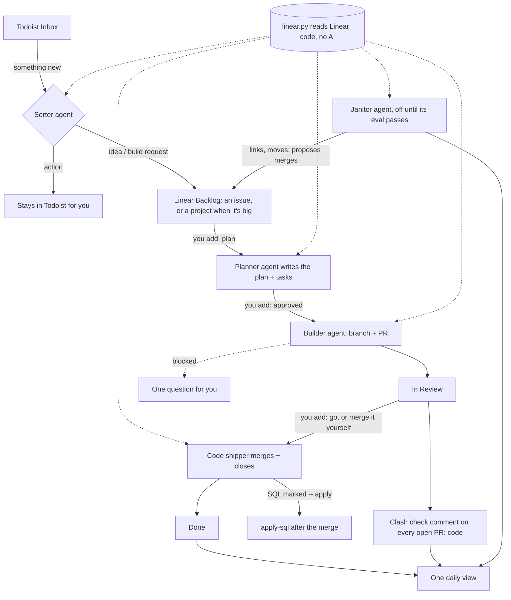

# CXJ Flow

**Talk ideas into Todoist. Approve with three labels in Linear. Claude Code agents plan, build and ship the rest.**

CXJ Flow runs on your own Mac (or Linux box) using the Claude Code you already have. Nothing gets built without your yes, and nothing ships without your `go`.

## Your three jobs

| You add this label in Linear | What happens (within 5 minutes) |
|---|---|
| `plan` on a **project** | The planner checks it isn't already built, then writes the plan into the project itself (Goal, Done when, Repo, steps; long material as a project document) and creates up to 8 plain issues under it. No sub-issues, so the project board and progress bar show everything. Nothing gets built yet. |
| `plan` on a single idea (an issue) | Same, for something small: a plan comment and 1–6 sub-tasks on that issue. |
| `approved` on the planned project or issue | Its tasks are queued. The builder does each one on its own branch, runs the checks and opens a PR. |
| `go` on a task in review | The shipper (plain code, no AI) checks the PR, merges it and closes the task. |

**One daily view, nothing else.** Every morning one message lists what shipped, each project against its plan, plans waiting for your yes, builds that need you, the open PRs with their clash check, anything Flow skipped after an error, and the week's plan adherence. Put an executable `notify.sh` in your Flow folder to receive it (one argument, the message; an optional second, a title): ntfy, Slack, a desktop alert. Keep the file out of git if it holds a private address. The only other pings are a clash on a PR, Flow losing Linear, a merged PR's SQL failing to apply, and (with the heartbeat) Flow stopping.

**Clash check.** Every open PR in the repos under `clash.repos` gets ONE comment, kept current: which live systems it touches (database, n8n, live messaging: per-repo path rules), other open PRs in the same area, the checks ("none configured" when a repo has no CI), and the apply-sql dry run of any `-- apply` SQL. It is rewritten only when something in it changes.

## What it never does
- Merge or ship without your `go`, or build anything you didn't approve
- Deploy, push to `main`, or touch production data, except SQL marked `-- apply` in a PR you merged, run through `apply_sql.command`
- Message anyone, spend money, or change anyone's pay or access
- Complete or delete your Todoist tasks
- Let the janitor close, merge or delete anything: it only links and moves, and asks you about the rest
- Work in repos you list under `skip_repos`

Agents run with Claude Code's permission checks on. Text inside issues and web pages is treated as data, not instructions.

## Setup (about 15 minutes)

**You need:** Claude Code (a paid Claude plan), the [GitHub CLI](https://cli.github.com) logged in, Python 3, a Linear workspace, and optionally Todoist.

1. In claude.ai → Settings → Connectors, connect **Linear** (and **Todoist**) for the planner and sorter agents. The runner itself reads Linear
   with an API key kept in the macOS Keychain (Linear → Settings → Security & access → API key):
   `security add-generic-password -s linear-api-key -a cxj-flow -w`. Optional, so the sorter only runs when the Inbox has something new:
   `security add-generic-password -s todoist-api-key -a cxj-flow -w`.
2. Clone this repo on the machine that will run the agents, open Claude Code in it, and say **"set me up"**. It interviews you and fills in:
   - `WORKFLOW.md`: your Linear team, the repos agents may work in, and the digest time
   - `context/COMPANY.md`: what your company does, who owns what, your systems, guardrails and priorities. Every agent reads this first.
   - `context/HOW-WE-WORK.md`: working rules (sensible defaults included)
3. In each Linear project's description, add a line `Repo: your-org/your-repo` so the builder knows where to work.
4. Run `./setup.sh` in a normal Terminal window. It checks your tools, creates the Linear labels, does a dry run and turns on the schedule.

Stop it any time with `./setup.sh --stop`.

**Keep your company files private.** Put `WORKFLOW.md` and `context/` in a folder of your own, for example inside a private repo, and run `FLOW_HOME=~/that-folder ./setup.sh`. The code stays a clean clone of this repo. With `self_update: true` it pulls both this repo and your folder on every tick.

## How it works
- `flow/runner.py` runs every 5 minutes. `flow/linear.py` reads Linear over its API (no AI call) and finds three things: tasks to build, tasks to ship and ideas to plan. An idle tick makes no model call. One failing item is logged and skipped, never the whole tick.
- **Builders** each get their own git worktree on the task's Linear branch. They're retried with back-off if they stall, and give up after 3 tries.
- **Gate agents** live in `flow/agents.py`: planner and Todoist sorter, one prompt each. The **janitor** (off until you
  set `janitor: on`) judges the board's structure once a day: overlapping projects, issues in the wrong project. It sees only
  a snapshot `linear.py` read and has no tools; `runner.py` makes its reversible moves (link two issues, move an issue to
  another project, each with a `[Janitor]` comment) and lists merges and duplicates in the daily view for your yes. Replay
  it on real cases of your own board first: `python3 evals/janitor/run.py` (cases in `$FLOW_HOME/evals/janitor/cases.json`).
- Shipping, the clash check and the clean-up (workspaces of finished tasks, logs older than 14 days) are plain code in `runner.py`.
- `flow/digest.py` builds the one daily view. `python3 flow/runner.py --self-check` runs the tests.
- Everything you'd want to change is in `WORKFLOW.md` (its YAML front matter is the config, its body is the builder's instructions) or in `context/`.

Logs are in `logs/`: `runner.log` for the timeline, and one file per agent run.

## Credits
The runner design (a `WORKFLOW.md` contract, polling, per-issue workspaces, retries and an "In Review" handoff) follows OpenAI's [Symphony](https://github.com/openai/symphony) spec. CXJ Flow adds the human gates, Todoist intake and Claude Code agents.

Made by [CXJ Labs](https://cxjlabs.biz). Apache-2.0.
