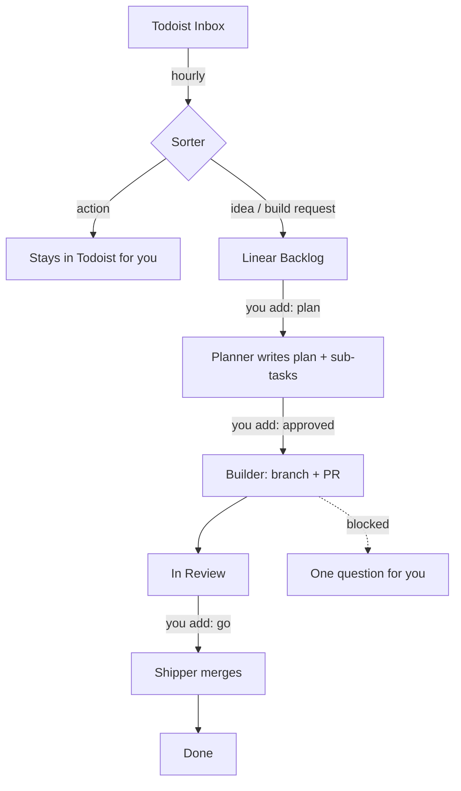

# CXJ Flow

**Talk ideas into Todoist. Approve with three labels in Linear. Claude Code agents plan, build and ship the rest.**

CXJ Flow runs on your own Mac (or Linux box) using the Claude Code you already have. Nothing gets built without your yes, and nothing ships without your `go`.

## Your three jobs

| You add this label in Linear | What happens (within 5 minutes) |
|---|---|
| `plan` on an idea | The planner checks it isn't already built, weighs it, and writes a plan with 1–6 small sub-tasks. Nothing gets built yet. |
| `approved` on the planned issue | Its sub-tasks are queued. The builder does each one on its own branch, runs the checks and opens a PR. |
| `go` on a task in review | The shipper checks the PR, merges it and closes the task. |

Every morning a Todoist task, **"Flow — Mon 12 Oct: 3 need your yes"**, lists what's waiting on you under four headings: *Plan it? · Approve plan? · Go? · Stuck?*

## What it never does
- Merge or ship without your `go`, or build anything you didn't approve
- Deploy, push to `main`, or touch production data (it writes migration files for you to apply)
- Message anyone, spend money, or change anyone's pay or access
- Complete or delete your Todoist tasks
- Work in repos you list under `skip_repos`

Agents run with Claude Code's permission checks on. Text inside issues and web pages is treated as data, not instructions.

## Setup (about 15 minutes)

**You need:** Claude Code (a paid Claude plan), the [GitHub CLI](https://cli.github.com) logged in, Python 3, a Linear workspace, and optionally Todoist.

1. In claude.ai → Settings → Connectors, connect **Linear** (and **Todoist**). CXJ Flow reaches them through Claude Code, so there are no API keys to manage.
2. Clone this repo on the machine that will run the agents, open Claude Code in it, and say **"set me up"**. It interviews you and fills in:
   - `WORKFLOW.md`: your Linear team, the repos agents may work in, and the digest time
   - `context/COMPANY.md`: what your company does, who owns what, your systems, guardrails and priorities. Every agent reads this first.
   - `context/HOW-WE-WORK.md`: working rules (sensible defaults included)
3. In each Linear project's description, add a line `Repo: your-org/your-repo` so the builder knows where to work.
4. Run `./setup.sh` in a normal Terminal window. It checks your tools, creates the Linear labels, does a dry run and turns on the schedule.

Stop it any time with `./setup.sh --stop`.

**Keep your company files private.** Put `WORKFLOW.md` and `context/` in a folder of your own, for example inside a private repo, and run `FLOW_HOME=~/that-folder ./setup.sh`. The code stays a clean clone of this repo. With `self_update: true` it pulls both this repo and your folder on every tick.

## How it works
- `flow/runner.py` runs every 5 minutes. A small, cheap Claude call reads Linear and finds three things: tasks to build, tasks to ship and ideas to plan. It starts the right agent for each, in the background.
- **Builders** each get their own git worktree on the task's Linear branch. They're retried with back-off if they stall, and give up after 3 tries.
- **Gate agents** live in `flow/agents.py`: planner, shipper and Todoist sorter, one prompt each.
- `flow/digest.py` writes the morning Todoist task.
- Everything you'd want to change is in `WORKFLOW.md` (its YAML front matter is the config, its body is the builder's instructions) or in `context/`.

Logs are in `logs/`: `runner.log` for the timeline, and one file per agent run.

## Credits
The runner design (a `WORKFLOW.md` contract, polling, per-issue workspaces, retries and an "In Review" handoff) follows OpenAI's [Symphony](https://github.com/openai/symphony) spec. CXJ Flow adds the human gates, Todoist intake and Claude Code agents.

Made by [CXJ Labs](https://cxjlabs.biz). Apache-2.0.
