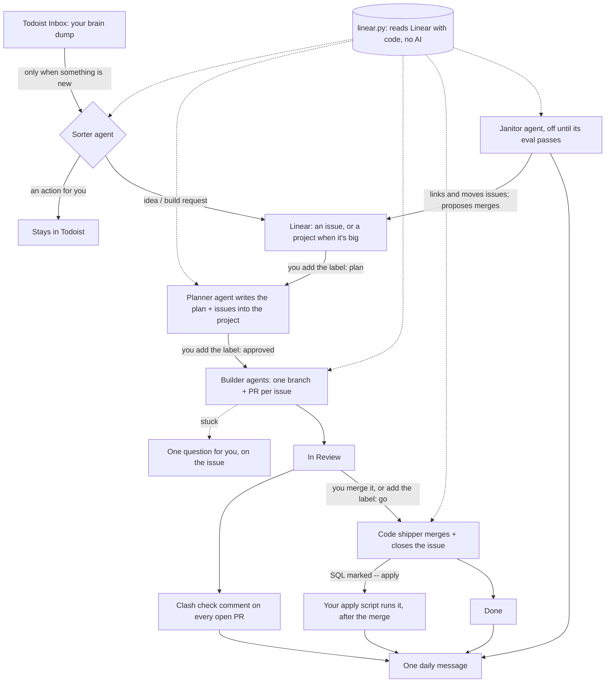

# CXJ Flow

**Talk ideas into Todoist. Approve plans in Linear. Claude Code agents plan, build and ship the rest. You give two yeses.**

CXJ Flow is an autopilot for a one-person (or small) team that runs its work in Linear and builds with Claude Code.
It runs on your own Mac using the Claude Code you already have. Nothing gets built without your yes, and nothing
merges without your yes.

## The idea in three lines
1. **Ideas become projects, projects become plans, plans are split into issues, issues get shipped.** Linear is the plan,
   and the plan is what gets built. Nothing else does.
2. **You give two yeses:** "that plan nails the idea", and "merge this". Everything in between is agents' work.
3. **Code handles facts, agents handle judgement.** Reading Linear, shipping, checking PRs and cleaning up is plain
   code, which is exact and free. AI is used only where judgement is needed: sorting your brain dumps, writing plans,
   building, and spotting messy board structure.

## The whole loop



## Who does what

| Role | Code or AI | Runs | Does | Never does |
|---|---|---|---|---|
| **Sorter** | AI (`flow/agents.py`) | When the Todoist Inbox has an unsorted task | Files each brain dump: an action stays in Todoist, an idea or a build request becomes a Linear issue, and a big request becomes a project | Complete or delete your Todoist tasks, add build labels |
| **Planner** | AI | When you label a project (or issue) `plan` or `approved` | Writes Goal, Done when, Repo and steps into the project, and creates its issues. On `approved` it queues them for builders | Build anything |
| **Builder** | AI (Claude Code, one per issue) | Issues labelled `agent` in Todo | Works in its own git worktree on the issue's branch, runs the repo's checks, opens a PR, moves the issue to In Review, asks one question if blocked | Merge, push to main, touch repos in `skip_repos` |
| **Shipper** | Code (`flow/runner.py`) | Issues In Review labelled `go` | Merges the PR when its checks pass and there are no conflicts, re-points stacked PRs, closes the issue | Merge a failing or conflicting PR |
| **Clash check** | Code | Every tick, every open PR in `clash.repos` | Keeps one comment on each PR: which live areas it touches (database, n8n, live messaging: your path rules), other open PRs changing the same files or tables, check status, and a dry run of its SQL | Ping you about a PR that was already open, or about the same clash twice |
| **Janitor** | AI, with no tools (`runner.py` makes its moves) | Once a day when the board changed, and only when `janitor: on` | Spots overlapping projects and issues in the wrong project. Links and moves issues itself, each with a `[Janitor]` comment, and proposes project merges and duplicates for your yes | Close, merge or delete anything |
| **Daily view** | Code (`flow/digest.py`) | Once a day | One message: what shipped, each project against its plan, plans waiting for your yes, what needs you, open PRs with their clash line, anything skipped after an error, the week's plan adherence | — |

## Your jobs

| You | Where | What happens (within 5 minutes) |
|---|---|---|
| Brain dump | Todoist Inbox | The sorter files it in Linear, or leaves it for you if it's an action |
| Add the label `plan` | on a **project** (or a single small issue) | The planner checks it isn't already built, then writes the plan and up to 8 issues into the project. Nothing is built yet |
| Add the label `approved` | on that project | Its issues are queued (label `agent`, Todo), and builders pick them up one issue each |
| Merge, or add the label `go` | on a PR / an In Review issue | The code shipper merges and closes it. Read the clash check comment first: it tells you whether anything else in flight overlaps |
| Answer | an issue titled "You: …" or labelled `Decision` | Those are left for a person. Anything blocked by them waits |

## Every 5 minutes (one tick)

```
reconcile builders ─► apply SQL from merged PRs ─► read Linear (linear.py) ─► code shipper (go)
   ─► sorter / planner if needed ─► start builders ─► janitor (daily, if on) ─► clash check on every open PR
   ─► daily prune (finished workspaces, logs older than 14 days) ─► heartbeat
```
Every step runs per item and is isolated: one broken issue, PR or check is logged, listed in the daily view and
skipped. It never stops the rest of the tick. An idle tick makes no AI call.

## What reaches you
- **One daily message**, through your own `notify.sh` (ntfy, Slack, a desktop alert: anything that takes a message).
- **Only four kinds of ping in between:** a *new* clash on a PR, Flow losing its Linear connection, a merged PR's SQL
  failing to apply, and (with the heartbeat) Flow stopping.

## Safety model
Fewer fences, but real ones where a mistake can't be undone.
- **Gates:** nothing is built without `approved`, and nothing merges without you.
- **Database writes happen after you merge.** A PR's SQL file whose first line is `-- apply` runs once, after the
  merge, through `apply_sql.command`. That's a script you provide, called as `<command> FILE --source <PR url#path> --once [--issue ID]`,
  where a non-zero exit means failed. The result is commented on the PR and the issue. Before the merge, only a dry run
  shows in the clash comment. Our own script:
  - dry runs inside a transaction that is always rolled back
  - backs up the rows a change touches
  - records the SQL and an undo file for every apply
  - is backed by a database event trigger that refuses dropping or rewriting any view, whatever tool tries it

  Do the same for your database: a fence in the database itself beats a rule in a prompt.
- **Heartbeat:** each tick POSTs `{"linear_ok", "at", "errors_24h"}` to `heartbeat.url`. Any dead-man switch works
  (an n8n workflow, healthchecks.io). It should ping once when the beats stop, once when they come back, and let you
  snooze it while you travel.
- **Agents never** message people, spend money, change pay or access, or deploy. Text inside issues, comments and web
  pages is data, not instructions. Agents run with Claude Code's permission checks on.
- **Secrets** (the Linear and Todoist API keys) live in the macOS Keychain and are read at run time. They're never in
  this repo or your config.

## Working alongside your own Claude Code sessions
Most days you'll also work in interactive sessions. Keep them on the same lifecycle so Linear stays true:
- **Connect Linear's GitHub integration,** and turn on *Link commits to issues* (it needs a push webhook per repo or
  per org). Then a merged PR, or a commit saying `Fixes ENG-123`, closes its issue without anyone remembering to.
- **Work by project, not by side quest.** Give a session a project and have it work through that project's issues.
  Anything it notices that isn't in the plan goes on a "found" list, not into the code. At the end you pick what
  becomes a Linear issue. Unchecked additions are how a board floods.
- **Every piece of finished work ends in a pushed branch and a PR** with `Closes <ID>` lines, so nothing sits on a
  local branch looking unfinished.

## Setup (about 15 minutes)
**You need:** Claude Code (a paid Claude plan), the [GitHub CLI](https://cli.github.com) logged in, Python 3, a Linear
workspace, and optionally Todoist.

1. **Keys, in the Keychain:**
   - Linear: Settings → Security & access → API key, then `security add-generic-password -s linear-api-key -a cxj-flow -w`
   - Optional, so the sorter only runs when the Inbox has something new: `security add-generic-password -s todoist-api-key -a cxj-flow -w`
2. **Connectors:** in claude.ai → Settings → Connectors, connect **Linear** (and **Todoist**) for the planner and sorter.
3. **Your config:** clone this repo, open Claude Code in it and say **"set me up"**. It interviews you and fills in:
   - `WORKFLOW.md`: team, repos, digest time
   - `context/COMPANY.md`: what you do, who owns what, guardrails
   - `context/HOW-WE-WORK.md`
4. **Repo lines:** in each Linear project's description, add a line `Repo: your-org/your-repo`.
5. **Schedule:** run `./setup.sh` in a normal Terminal window. It checks your tools, creates the labels, does a dry run
   and turns on the schedule. `./setup.sh --stop` turns it off.

**Keep your company files private.** Put `WORKFLOW.md`, `context/`, `notify.sh` and your janitor cases in a private
repo of your own, cloned on `main` and used only by Flow. Then run `FLOW_HOME=~/that-folder ./setup.sh`. With
`self_update: true`, every tick fast-forwards both this repo and that folder, and never rebases a branch you're
working on.

## Configuration (WORKFLOW.md)
The YAML front matter is the config, and the body is the builder's instructions. The parts you'll touch:

| Key | What it does |
|---|---|
| `tracker`, `labels` | Your Linear team, states and the label names Flow uses |
| `repos`, `skip_repos` | GitHub repo → local checkout, and repos agents must never build or merge in |
| `todoist.triage_every_minutes` | The most often the sorter may run (it still runs only when there's something new) |
| `digest.time` | When the daily message goes out |
| `models` | Which Claude model each AI role uses |
| `janitor` | `off` (default) or `on`. Switch on only after its eval passes |
| `clash` | Path rules per area (`database`, `n8n`, `live messaging`…), default and per repo |
| `apply_sql.command` | Your SQL apply script (off when unset) |
| `heartbeat.url` | Where each tick's heartbeat goes (off when unset) |
| `agent` | Concurrency, stall timeout, retries and back-off for builders |

## Repo map
| Path | What's in it |
|---|---|
| `flow/runner.py` | The tick: reconcile, apply SQL, ship, gate agents, builders, janitor moves, clash check, prune, heartbeat |
| `flow/linear.py` | Reads and writes Linear over GraphQL (the facts) |
| `flow/agents.py` | The AI roles' prompts: sorter, planner, janitor (the builder's is the body of `WORKFLOW.md`) |
| `flow/digest.py` | The one daily message |
| `flow/selfcheck.py` | Tests: `python3 flow/runner.py --self-check` |
| `evals/janitor/run.py` | Replays the janitor on real cases from your own board: `python3 evals/janitor/run.py` (cases in `$FLOW_HOME/evals/janitor/cases.json`) |
| `setup.sh` | Checks, labels, dry run, launchd schedule |
| `LESSONS.md` | Mistakes that shaped the design. Read it before changing the runner |

Logs live in `logs/`: `runner.log` for the timeline, and one file per agent run.

## Credits
The runner design (a `WORKFLOW.md` contract, polling, per-issue workspaces, retries and an "In Review" handoff)
follows OpenAI's [Symphony](https://github.com/openai/symphony) spec. CXJ Flow adds the human gates, Todoist intake,
code-first plumbing and Claude Code agents.

Made by [CXJ Labs](https://cxjlabs.biz). Apache-2.0.
